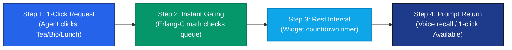
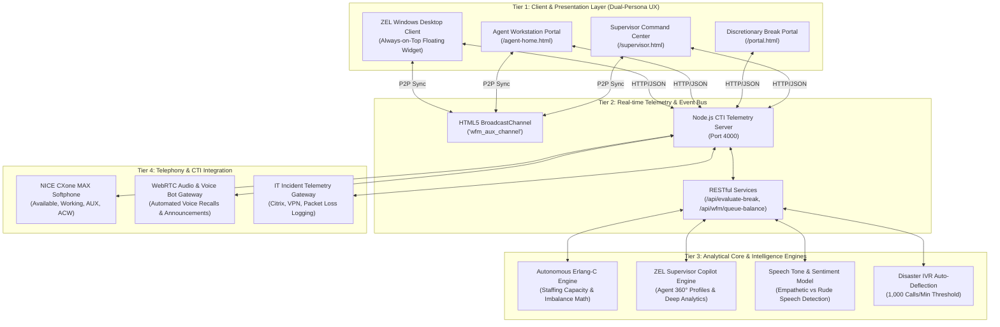

# ZEL: Autonomous WFM & AI Copilot Platform
## System Architecture & Technical Specification

> **Bot Name**: **ZEL**  
> **Official Tagline**: *"Zero wait to leave, zero wait to return"*  
> **Version**: 2.5 (Enterprise Architecture)  
> **Target Platform**: NICE CXone CTI, Windows Electron Desktop, Web Telemetry Gateway  
> **Deliverables Included**: `.pptx` (4-Slide Executive Deck), `.docx` (Full Spec), `architecture_diagram.svg`

---

## 1. Executive Summary & Brand Identity

**ZEL** is an autonomous AI-powered Workforce Management (WFM) companion engineered for NICE CXone contact center environments. 

Built around the core mission of **“Zero wait to leave, zero wait to return”**, ZEL solves the dual friction points of legacy call centers:
1. **Zero Wait to Leave**: Agents no longer wait 15–20 minutes in supervisor chat queues asking for permission to take a tea, bio, or lunch break. With a single click inside the floating desktop companion, ZEL evaluates real-time Erlang-C staffing capacity (`<100ms`). If queue depth allows, the break is approved autonomously.
2. **Zero Wait to Return**: During rest intervals, ZEL provides an on-screen visual countdown timer to maintain schedule adherence. If an intraday call surge occurs or when the interval concludes, ZEL prompts the agent or rings their softphone via automated text-to-speech desk recalls, ensuring prompt return without manual supervisor chasing.

---

## 2. Frictionless 4-Step Operational Flow

### Traditional Process vs. ZEL Autonomous Experience

| Feature | Legacy Contact Center | With ZEL Autonomous Copilot |
| :--- | :--- | :--- |
| **Break Request** | Form submission or chat message | **1-Click in floating desktop widget** |
| **Approval Latency** | **10–20 minutes** (Supervisor delay) | **<100 ms (Zero wait to leave)** |
| **Staffing Evaluation** | Manual spreadsheet estimation | **Real-time Erlang-C capacity gating** |
| **Rest Interval Tracking** | None (Agents guess elapsed time) | **Live on-screen countdown timer** |
| **Desk Return** | Manual floor chasing / Overages | **Automated voice bot desk recall** |
| **Surge Response** | Panic, long hold times, SLA crash | **1-Click dynamic cross-skill rebalance** |

---

## 3. End-to-End System Architecture

---

## 4. Scoped Supervisor-to-Agent Governance Matrix

ZEL automatically scopes floor telemetry, break approvals, reports, and QA scorecards to each supervisor's assigned team:

| Supervisor | Supervisor ID | Focus Area | Assigned Direct Report Agents |
| :--- | :--- | :--- | :--- |
| **Sarah Jenkins** | `SUP-014` | Floor Lead & Customer Service | Samantha Vance (`AGT-9102`), Rachel Green (`AGT-6512`), Marcus Brody (`AGT-8819`), Chloe Bennett (`AGT-3310`) |
| **Michael Chang** | `SUP-021` | Billing & Retention Manager | Jordan Miller (`AGT-4092`), Lucas Wright (`AGT-5521`), Maya Patel (`AGT-7703`) |
| **Elena Rostova** | `SUP-035` | QA & Tier-2 Tech Support Lead | Alex Morgan (`AGT-8842`), Carlos Mendez (`AGT-4491`) |
| **David Sterling** | `SUP-042` | Emergency Inbound & Dispatch | David Chen (`AGT-7740`), Olivia Taylor (`AGT-6628`) |
| **Priya Sharma** | `SUP-059` | WFM Scheduling & Trainee Lead | Liam O'Connor (`AGT-2219`) |

---

## 5. Deliverables & Artifacts

* **PowerPoint Presentation (4 Slides)**: [`NICE_CXone_WFM_Copilot_Architecture_and_Overview.pptx`](file:///c:/Users/GenAIKOCVISUSR7/Desktop/aux-chatbot/NICE_CXone_WFM_Copilot_Architecture_and_Overview.pptx)  
  * *Slide 1*: Cover featuring **ZEL**, tagline *"Zero wait to leave, zero wait to return"*, and mascot visual.
  * *Slide 2*: 4-Step interactive pipeline flow with step cards and Before/After comparison.
  * *Slide 3*: Dual-persona agent & supervisor visual workflow cards.
  * *Slide 4*: Measurable ROI & 4 high-impact metric cards.
* **Word Technical Specification**: [`NICE_CXone_WFM_Copilot_Architecture_and_System_Design.docx`](file:///c:/Users/GenAIKOCVISUSR7/Desktop/aux-chatbot/NICE_CXone_WFM_Copilot_Architecture_and_System_Design.docx)
* **High-Resolution Architecture Diagram**: [`architecture_diagram.svg`](file:///c:/Users/GenAIKOCVISUSR7/Desktop/aux-chatbot/architecture_diagram.svg)
